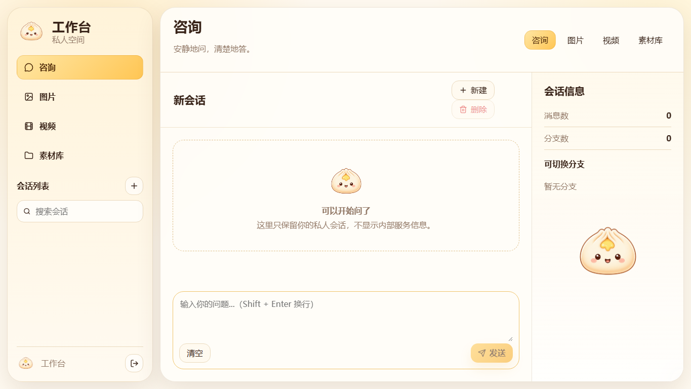

<!-- Project artwork created for this repository. -->
<p align="center">
  
</p>

<h1 align="center">CSTD Design</h1>

<p align="center">
  
</p>

**A personal AI studio for chat, image generation, video experiments, and saved media.**

<p align="center"><a href="#inside-the-studio">Inside the studio</a> &nbsp; · &nbsp; <a href="#run-locally">Run locally</a> &nbsp; · &nbsp; <a href="#development">Development</a></p>


<p align="center">
  
</p>

<sub>A saved local workspace screenshot with an empty conversation. The app interface is primarily Chinese.</sub>


## Inside the studio

- Streaming chat with conversation branches, follow-up threads, and search.
- Image generation and editing with reference images.
- Video generation with job progress and previews.
- A media library for uploads and generated work.

The interface is primarily Chinese. The hosted workspace requires a password and your deployment needs its own AI provider credentials.

## Run locally

Use Node.js **24+**. Install dependencies and copy `.dev.vars.example` to `.dev.vars`.

```bash
npm ci
```

Fill in the password hash, session and asset secrets, and provider key described in the [setup reference](docs/MAINTENANCE.md). Check the D1 and R2 bindings in `wrangler.toml`, then run:

```bash
npm run build
npx wrangler d1 migrations apply cstd-design --local
npm run pages:dev
```

## Development

```bash
npm test
npm run lint
npm run typecheck:functions
```

`src/` contains the interface; `functions/` contains the API and shared backend logic. See the [maintenance reference](docs/MAINTENANCE.md) for deployment, authentication, and browser checks.

This personal project is not currently accepting outside contributions. Issues are welcome. Licensed under [MIT](LICENSE); see also [NOTICE](NOTICE).
